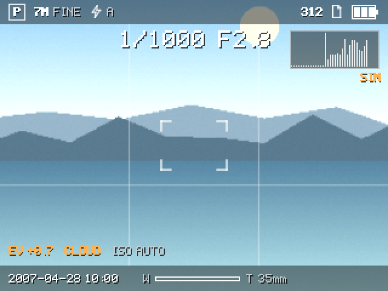

# S650 native platform (desktop simulation)

An independently written **C++17 implementation of the Version 2.0 Sony-inspired interface**, with a hardware abstraction layer, running on a desktop computer against **simulated** camera, storage, display and button backends.

> ## This is not camera firmware and does not run on the camera
> - It runs only on a development computer. Nothing here has been run on, flashed to, or connected to a Sony DSC-S650.
> - Every camera function is **simulated** (procedural live view, invented exposure values, fake capture). The `SIM` tag on the shooting screen and the "Camera status" view say so.
> - A real-camera port would need an execution environment, boot path, executable format, display and input drivers and camera functions that are **unknown** today. See `docs/PLATFORM-RESEARCH.md` and `docs/HARDWARE-REQUIREMENTS.md`.
> - Unofficial; not affiliated with or endorsed by Sony. No Sony logo artwork, typeface, or firmware is used.



## What exists
| | Status |
|---|---|
| C++17 library + executable, no third-party dependencies | **Built and tested** (macOS, Apple clang 17, CMake 4.4) |
| Software framebuffer (320×240) with AA lines, alpha, clip, scaling, bitmap font, vector icons | **Built and tested** |
| Backend interfaces: Display, Input, Camera, Storage; Clock | **Built** |
| Desktop backends: headless display (PNG), scripted input, simulated camera, simulated storage with file-backed settings | **Built and tested** |
| `UnavailableCamera`: every call fails visibly (stand-in for a missing hardware port) | **Built and tested** |
| macOS window backend (Cocoa, system frameworks only) | **Launch smoke-tested only** (see Limitations) |
| UI: shooting overlay, 8-category menu with Setup, display options with live preview, playback with slideshow/protect/delete, startup/shutdown, 3 themes | **Built and tested on the desktop** |
| Anything running on the real camera | **None** |

Tests: `93 tests, 5,217 checks` pass (Release); the original 86 tests are unchanged. The same suite passes under UndefinedBehaviorSanitizer; AddressSanitizer could not run in the test environment, so memory-error checking is still outstanding. See `docs/DEVELOPMENT-ROADMAP.md` for what each covers and what failed along the way.

## Build and run
```sh
cmake -S . -B build            # Release by default; -DCMAKE_BUILD_TYPE=Debug for debug
cmake --build build -j
./build/s650_tests             # or: ctest --test-dir build
./build/s650_native --tour out # headless: writes 20 PNG screenshots into ./out (create it first)
./build/s650_native --tour out --no-camera   # 3 screenshots showing how a missing camera backend fails visibly
./build/s650_native --window   # macOS window (also the default with no arguments)
```
Options: `--fast` skip the startup animation, `--settings FILE` persist settings, `--no-camera` use `UnavailableCamera`, `--scale N`, `--frames N`, `--help`.
On non-macOS systems configure with `-DS650_WITH_WINDOW=OFF` (the window backend is the only platform-specific code; the headless tour and tests work everywhere a C++17 compiler does, untested outside macOS).

### Keys (window backend)
Arrows = control button, Enter = OK, Esc = Back, M = Menu, P = Playback, D = DISP, W/T = zoom, Space = shutter (hold = focus, release = shoot), `[` `]` = mode, O = power, Delete = delete (playback), K = protect (playback). Mouse and touch are not used.

## Experimental S650 target (research; nothing runs on the camera)
`target/`, `cmake/s650-target.cmake` and `tools/target-build/` hold a separate cross-compilation setup (LLVM + lld, MIPS, both byte orders, three ISA levels) and a first bare-metal test program. `tools/target-build/build.sh` builds 12 variants; `qemu-verify.py` runs 6 of them on an **emulated generic MIPS32 4KEc** (all pass). That proves the toolchain output is valid MIPS, **not** that the camera can run it. The ZR36473's actual core, endianness, memory map, boot path and loader are unknown. Details: `docs/TARGET-ARCHITECTURE.md`, `docs/CROSS-COMPILATION.md`, `docs/EXECUTION-ENVIRONMENT.md`, `docs/FIRMWARE-ANALYSIS.md`, `docs/DISPLAY-INTEGRATION.md`, `docs/RECOVERY-REQUIREMENTS.md`. The desktop application itself does not yet compile without a standard library (0 of 24 sources; see the port matrix).

## Status (round 9): what is real and what is not
- **Desktop:** C++17 interface, backends, **93 tests / 5,217 checks passing**; raw-framebuffer display backend (RGB565 etc.) runs the unchanged UI at 480x240; LCD test pattern with reference files.
- **Tooling:** `tools/firmware-analysis/` (read-only analysis toolkit, 20 tests); `tools/target-build/` (12 MIPS variants, emulator checks, variant comparison); `tools/portability/` (measured dependency report).
- **Target:** experimental MIPS toolchain only. Generic binaries pass on **emulated** MIPS32 cores (`hello` 6/6, `mips_sample` 24/24); an ISA probe distinguishes Release 1 from Release 2 cores. **Nothing has run on the camera**; its core, endianness, boot path, memory map, display programming and loader are unknown. The camera has been left closed and untouched.
- **Portability:** 4 of 29 application sources compile freestanding after header splits (was 0); route 4 (freestanding UI core + platform services from the original firmware) is the target architecture.
- **Firmware:** no S650 firmware or update package located; Sony download pages are blocked to my tools (one manual check by you is suggested in `docs/DEVELOPMENT-ROADMAP.md`).
See `docs/INDEPENDENT-REVERSE-ENGINEERING.md` for the overview and `docs/HARDWARE-PROFILE.md` for the evidence-classed hardware facts.

## Layout
```
include/ src/       core (settings, clock, power, application), display (framebuffer, font, icons, PNG, scenes),
                    input, camera, storage, ui (screens, widgets, HUD, theme, boot)
tests/              93 tests, own tiny harness (no framework)
tools/gen_strings.py  regenerates the English string table from the browser prototype
docs/               ARCHITECTURE, HARDWARE-REQUIREMENTS, PORTABILITY, PLATFORM-RESEARCH, DEVELOPMENT-ROADMAP, screenshots
assets/             reserved (fonts, icons and graphics are currently code, not files)
```
The visual and behavioural reference is `~/projects/s650-interface-concept/` (Version 2.0) and its `S650-INTERFACE-PORTING-SPEC.md`.

## Differences from the browser version (known, intentional or pending)
- **English only.** The built-in bitmap font has no accented glyphs, so French and German are not ported. The Language row shows English only.
- **No audio** (beeps, chimes).
- **Fonts:** a 5×7 hand-drawn bitmap font (scaled 2×/3×) replaces the system fonts; "Cyber-shot" is not italic and "SONY" is plain letter-spaced type.
- Icons are simplified re-drawings.
- Scenes are simpler than the browser's drawn photographs.
- Screen-reader announcements exist as a text channel (`UIController::lastAnnouncement`) used by tests, not as speech.

## Limitations (what has and has not been verified)
- Tested on one machine and one compiler. UndefinedBehaviorSanitizer: clean. AddressSanitizer: **not done** (it hangs even on a trivial program in this environment), so memory-error checking is open.
- **Window backend:** it launches, runs 150 frames and exits cleanly. Its on-screen appearance and real keyboard handling could **not** be checked in this session (no screen-capture access), so treat it as unverified. The headless PNG output is what the screenshots show.
- Timing in tests uses a manual clock, so real-time performance on a camera-class CPU is unknown.
- The 320×240 logical size is an assumption; the real panel grid is unverified.

## Safety and scope
Development and research only. No camera communication, USB commands, service modes, update utilities, flash/NAND access, board probing, or opening of the camera has taken place, and none is authorised by this project phase.
# s650-native-platform
